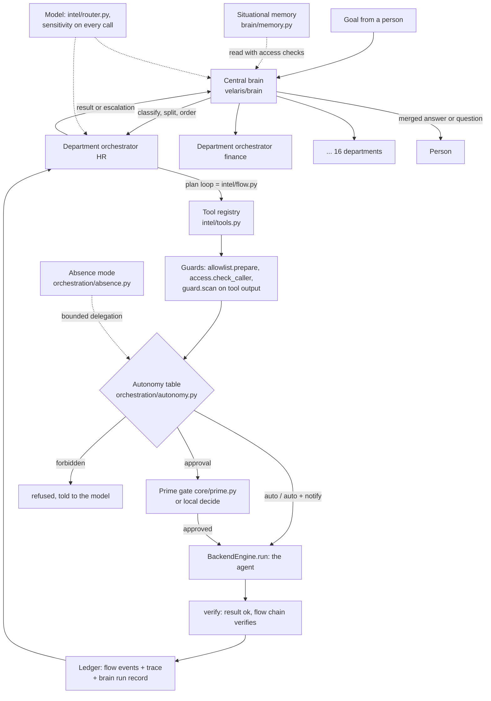

# Central brain and the control hierarchy (design)

Jira KAN-28, built by KAN-29 to KAN-34. Read `docs/orchestrators.md` first: it
says what exists today. This page says what was added and why it is shaped this
way. Where the code differs from this page, the code wins and this page is wrong.

## 1. The hierarchy ("neural schema")



Rule of the whole design: a model proposes, code disposes. The model chooses
which tool to try next. It never decides whether the tool may run, who approves,
what data it may see or how much it may spend. Those are deterministic code in
`allowlist.py`, `access.py`, `autonomy.py`, `policy.py`, `usage.py` and the limits
in `flow.py`.

## 2. Decisions

| # | Decision | Evidence / reason |
|---|----------|-------------------|
| 1 | The run loop is `intel/flow.py`, extended, not replaced. | It already has events in a hash chain, approvals bound to the call hash, restart safety, a Prime gate, and is used by API, chat, mail, control and JIRA. Added: cost and time caps, loop detection, escalation, routed model calls with a sensitivity (KAN-30). |
| 2 | `agentkit/graph.py` is used as a helper, for dependency order of multi-department plans. | It only orders; it is exactly what the brain needs for "payroll after leave approval". |
| 3 | ORCHESTRIX is neither replaced nor wrapped. It stays as it is and is not used. | It is a recursive topological sort, no caller except the CONVERGENCE_BRIDGE alias, raises a bare Exception on a cycle and silently accepts unknown dependencies (see orchestrators.md). `graph.order` does the same job better and already has 9 importers. Deleting ORCHESTRIX is the owner's call (KAN-102 / register item A5). |
| 4 | Tools = the allowlist. Nothing outside `allowlist.METHODS` can be a tool. | The owner-reviewed table of callable methods and caller rules already exists; a second table would drift. |
| 5 | One approval path: the existing Prime gate (or local decide when no gate is set). | `core/prime.py` is pull-based and fail-closed. The brain and the orchestrators never approve anything themselves. |
| 6 | Models only through `intel/router.py`, with a sensitivity on every call. | A run's sensitivity is the highest of its tools'. An unlisted tool is restricted, so a run that touches it can only use providers cleared for restricted data. |
| 7 | The autonomy table is code with owner overrides in a state file. Conservative defaults; some classes cannot be loosened by an edit. | KAN-33. See section 6. |
| 8 | Executive absence never approves locally when a Prime gate is configured. | Approvals must go through Prime; Prime owns delegations. See section 8. |
| 10 | A person's current identity is looked up at the moment of use (`orchestration/identity.py`); roles saved in a run or a delegation are only an upper bound. | Velaris has no user directory, identities arrive signed from the gateway. Until a resolver is installed (`identity.set_resolver`) only the person themselves can advance their own runs, and a delegation cannot be used. |
| 9 | Tool-less departments get an orchestrator that can only answer and escalate. | Only 6 of 16 departments have allowlisted methods. Widening the allowlist is a security review, not part of this epic. |

## 3. From a goal to a plan

1. A person (a `Caller`) gives the brain a goal in words.
2. The brain asks the model (task class `planner`, sensitivity internal) for a
   JSON plan: `{"questions": [...]}` or `{"steps": [{"id", "department", "goal",
   "depends_on": [ids]}]}`. The prompt lists the 16 departments with their scope
   lines. The goal is wrapped as data (`guard.wrap`).
3. Code validates the plan: every department must exist, ids unique, at most 8
   steps, no cycle (`agentkit.graph.order`). An invalid plan is one retry, then
   a question to the person. A plan with `questions` (ambiguous goal) is returned
   to the person; nothing runs.
4. Steps run in dependency order (levels from `graph.order`). Each step becomes a
   run of the department orchestrator with the sub-goal and the results of the
   steps it depends on (as data).
5. Results are merged into one answer. A step that ends `waiting_approval`
   pauses that branch and everything that depends on it; independent branches
   continue.

## 4. Picking a department

Model proposes, code checks. The model sees department names and one-line scopes
and answers with names. Names not in the registry are dropped. If nothing valid
is left, the brain asks the person; it never guesses a default department.

## 5. Shared situational memory (`brain/memory.py`)

What the brain knows between requests, per organisation:

* open approvals: read from the flow store (`Flow.waiting`), never copied;
* in-flight work: the brain's own run records (goal, steps, department run ids, status);
* per-person context: short notes about a person's current work, keyed by person.

Access rules, all in code: a caller reads their own organisation only
(`access.may_read_scope`); person context is readable by that person or by a
governance admin; a note is plain text capped in size and passed through
`guard.redact` before it is stored (no secrets or identifiers in memory); memory
content is given to a model only as fenced data. Pay, bank, identity and health
data are never stored in memory; they stay in their agents behind
`authorize_read`.

## 6. Limits, escalation, and the autonomy table

Per run (flow.py): turns, spend (USD), active seconds, repeated identical call,
unusable replies in a row, model outages. Each stop is recorded and calls the
escalation hook once. Defaults of a department orchestrator: 12 turns, USD 0.50,
120 s, 3 repeats, 3 invalid, 3 model errors. All configurable per department.

Escalation targets, in order: the brain (a department run that stops is a
`failed` step with the reason), then a person (the brain returns a question or a
"needs a human" result carrying the run id). A step that needs approval is not a
failure: it is the approval path.

Autonomy table (KAN-33), keyed by action class:

| class | default mode | can the owner loosen it? |
|-------|--------------|--------------------------|
| read | auto | yes |
| personal_data_read | auto, notify | yes |
| internal_write | auto + notify | yes |
| unclassified (an act method nobody classified) | approval | yes |
| money_under_limit | approval (limit 0 until set) | yes (set a limit and a mode) |
| money_over_limit | approval | no |
| external_message | approval | no |
| personal_data_export | approval | no |
| access_change | approval | no |
| irreversible (delete, erase, void, purge) | approval | no |
| deployment | approval | no |
| legal_filing | approval | no |

"No" means the table refuses to store `auto` for that class; lifting that is an
owner decision made in code, not in the dashboard. A class mapped to `forbidden`
makes the orchestrator deny the call and tell the model.

## 7. When the model is unavailable

`router.complete` fails over along the chain; a breaker opens per provider. If
the chain is exhausted or the policy or budget refuses (kill switch, monthly
budget, no provider cleared for the sensitivity), the run stops at once with the
reason (`policy_refused`, `budget_exceeded`) or after 3 model errors
(`model_unavailable`), and is escalated. Nothing is retried forever and nothing
falls back to a provider that may not see the data. The brain, when its own
planning call fails, answers with the department list and asks the person to
pick one.

## 8. Executive absence (KAN-34)

A person (the principal) records a delegation: who acts for them (the brain's
service id), which action classes and departments, a money limit, a start and an
end. Bounds in code: duration at most 90 days (the AetherOS Prime hard maximum),
amount at most the Prime ceiling (5,000,000), classes limited to the
delegable ones (money under limit, internal write, unclassified, personal data
read); irreversible, external message, personal data export, access change,
deployment and legal filing are never delegable. Created by the principal or a
governance admin; revoked by either at any moment; takes effect when its start
time is reached and stops at its end.

During the window, a step that needs approval and falls inside the delegation
is approved by the delegation (recorded as a decision by `delegate:<principal>`
with the delegation id) when the deployment decides locally. When a Prime gate is
configured the brain cannot approve locally: such steps are queued exactly like
any other waiting step and the delegation is listed in the briefing so the
approver in Prime can apply Prime's own delegation. Everything outside the window
or scope waits. At the moment of use the principal's CURRENT roles are looked up
(effective authority = roles recorded AND current roles); a principal who is
inactive, or who lost a role the delegation relies on, auto-revokes it, and one
whose identity cannot be verified covers nothing. Every use is written to an append-only ledger and the trace. The
return briefing lists, per delegation: decided under it, waiting, escalated.

## 9. Observation

The brain run id is the trace id of a request. It is stored in the `meta` of
every department run (`meta.brain_run`, `meta.department`) and written to the
trace with the department run id (`orchestration.dispatch`). A department run id
leads to every step through the hash-chained flow events, which are anchored in
the global trace. `GET /flows/{run_id}/verify` and `/trace/verify` check the
chains.

## 10. Example: "approve Priya's leave, update payroll and the project plan"

```mermaid
sequenceDiagram
  participant U as Manager
  participant B as Brain
  participant HR as HR orchestrator
  participant F as Finance orchestrator
  participant PM as Project orchestrator
  participant Prime as Prime gate
  U->>B: goal
  B->>B: model plan: hr -> finance, hr -> project_management (graph.order)
  B->>HR: run "approve leave 42"
  HR->>HR: tool LEAVE_MANAGEMENT.approve (internal write; role hr_admin checked)
  HR->>Prime: needs approval (autonomy: approval)
  Prime-->>HR: approved by hr.head (pull)
  HR-->>B: done
  par independent branches
    B->>F: "adjust payroll for the leave"
    F-->>B: waiting_approval (money class: approval)
  and
    B->>PM: "update the project plan"
    PM-->>B: done / or: no tool, escalated
  end
  B-->>U: merged answer: what is done, what waits for whom
```

The honest limit of the example today: payroll agents expose reads only in the
allowlist and the project-management department has no allowlisted method, so
the finance and project steps end as "no tool, escalated" until those methods
are reviewed into `allowlist.py`.

## HTTP

`POST /brain {"goal"}` plans and runs the goal; `GET /brain/{run_id}` moves it on after an approval. Roles come from the signed
assertion; a run belongs to its owner alone (the `/flows` rule). Code: `velaris/api/brain_api.py`.

