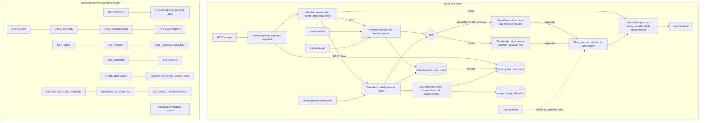

# Orchestration today

Jira KAN-27. Written from the code in this worktree, not from agent names or
manifests. Paths are relative to the repository root. "A/" below means
`departments/_ai_core/`. Line numbers are from this checkout.

## 1. Summary

Velaris has exactly one model-driven run loop, `velaris/intel/flow.py`
(`Flow`). It has one approval path: the allowlist (`velaris/api/allowlist.py`)
turns an ACT method into a one-step `Flow.call` that waits for a decision,
either local (`POST /flows/{id}/decide`) or pulled from AetherOS Prime
(`velaris/core/prime.py`, `PrimeGate`). It has one dispatch path to an agent,
`BackendEngine.run` (`velaris/backend/engine.py:50`), which the HTTP API uses
for READ methods and for approved ACT steps. Chat, mail and control reuse
`Flow`; none has its own loop.

The agents with "orchestrator", "router", "core" or "supervisor" in their names
are, with one exception, in-memory or file-backed rule helpers that nothing
calls at runtime. Of all the components in scope only `MODEL_COUNCIL.deliberate`
is in the HTTP allowlist (`velaris/api/allowlist.py:129`). ORCHESTRIX is a
topological sort that runs nothing, and its only non-test reference is the
CONVERGENCE_BRIDGE alias. There is no per-department orchestrator anywhere
(`find departments -maxdepth 2 -iname '*ORCHESTR*'` finds ORCHESTRIX and
RESOURCE_ORCHESTRATOR only, and the second is a capacity ledger).

The things Flow lacks that an orchestration layer needs are: a cost cap per
run, a wall-clock cap, loop detection in the base class, escalation, a model
call that goes through `velaris/intel/router.py`, and a sensitivity level on
that call. Section 5 lists them.

## 2. What is wired at runtime

Edges not drawn because nothing uses them: `AgentRouter.publish`,
`intel/router.py`, `intel/workflow.py` as an executor (it only analyses).

## 3. The table

Verdicts: real = does what its name says and a runtime path reaches it;
partial = does real work but no runtime path reaches it, or only a part is
real; decorative = does not do what its name suggests and nothing uses it.

| Component | Path | What it does | Called by (non-test) | Calls | Wired | Verdict |
|---|---|---|---|---|---|---|
| Flow | velaris/intel/flow.py | model-driven run loop, approvals, event log | api/app.py, chat/assistant.py, mail/outbound.py, control/planner.py+service.py, _connectors/JIRA/atlassian.py | LLM, guard, trace | yes | real |
| allowlist | velaris/api/allowlist.py | READ/ACT table, per-method rules | api/app.py | access.authorize_read, check_caller | yes | real |
| PrimeGate | velaris/core/prime.py | pull-based approvals from AetherOS Prime | api/app.py (Settings.from_env), control, mail via gate | httpx to Prime | when env set | real |
| BackendEngine.run | velaris/backend/engine.py | the one dispatch path | api/app.py, main.py (status only) | agent classes | yes | real |
| AgentRouter | velaris/agents/router.py | imports every agent module | engine.py, SELF_AUDIT | importlib | yes | real (loader only) |
| agentkit/graph.py | velaris/agentkit/graph.py | order / cycle / reachable helpers | 9 agents (see 4.3) | nothing | indirect | real helper, not a runner |
| intel/router.py | velaris/intel/router.py | fallback chains, breaker, sensitivity filter | only tests | llm gateway, policy | no | partial |
| intel/council.py | velaris/intel/council.py | multi-model answer and blind review | MODEL_COUNCIL, intel CLI | LLM | yes via MODEL_COUNCIL | real |
| intel/workflow.py | velaris/intel/workflow.py | n8n export analyser | WORKFLOW_ANALYST, intel CLI | nothing | agent not allowlisted | decorative as orchestration (analysis only) |
| ORCHESTRIX | A/ORCHESTRIX | recursive topo sort, level grouping | CONVERGENCE_BRIDGE alias only | nothing | no | decorative |
| CONVERGENCE_BRIDGE | departments/operations | alias to ORCHESTRIX, COHERENCE_SYNC_CORE, REGISTRY | nothing | Delegator | no | decorative |
| VCAS_CORE | A/VCAS_CORE | route, authorise, wait, run a task | only tests | VCAS_ROUTER, SUPERVISOR, AUTOPILOT, trace | no | partial |
| VCAS_ROUTER | A/VCAS_ROUTER | is a handler registered | VCAS_CORE | task_error | no | partial |
| VCAS_SUPERVISOR | A/VCAS_SUPERVISOR | PRIME.authorize for a task | VCAS_CORE, VCAS_ROUTER (task_error) | PRIME agent | no | partial |
| VCAS_AUTOPILOT | A/VCAS_AUTOPILOT | run a registered handler once, digest-bound | VCAS_CORE | trace, JsonState | no | partial |
| EOF_CORE | A/EOF_CORE | validate, order, policy-check, queue a plan | CORE_CONVERGENCE alias only | graph.order, EOF_POLICY, EOF_GATEWAY | no | partial |
| EOF_POLICY | A/EOF_POLICY | check a step against rules | EOF_CORE, NEURAL_POLICY_MESH | aicore_b_rules | no | partial |
| EOF_GATEWAY | A/EOF_GATEWAY | durable inbox files per agent | EOF_CORE | guard, trace | no (nobody calls receive) | partial |
| MODEL_COUNCIL | A/MODEL_COUNCIL | wrapper over intel/council | allowlist READ | council | yes (READ) | real |
| PRIME (agent) | A/PRIME | local grants and authorize | VCAS_SUPERVISOR, FSCL alias | trace, ENGINE | no | partial |
| ACF_ROUTER | A/ACF_ROUTER | first-matching rule picks a destination | ACF_CORE | guard | no | partial |
| ASEL_ROUTER | A/ASEL_ROUTER | assign steps to least-loaded capable handler | ASEL alias only | nothing | no | partial |
| MCFE_ROUTER | A/MCFE_ROUTER | domain to department table | MCFE_CORE | department_dirs | no | decorative |
| VHOE_ROUTER | A/VHOE_ROUTER | pick least-utilised worker | VHOE_OPTIMIZER | nothing | no | partial |
| AAE_POLICY | A/AAE_POLICY | allow / require_approval / deny rules | AAE_RUNTIME | conditions | no | partial |
| AAE_RUNTIME | A/AAE_RUNTIME | run one approved action once, journal | ADAPTIVE_ACTION_ENGINE | AAE_POLICY, trace | no | partial |
| HUMAN_APPROVAL_WORKFLOW | A/HUMAN_APPROVAL_WORKFLOW | in-memory request book | only tests | check_caller | no | decorative |
| RECURSIVE_GOAL_PLANNER | A/RECURSIVE_GOAL_PLANNER | flatten nested goals, order | AIIE_KERNEL (string table) | graph.order, LLM (decompose) | no | partial |
| RESOURCE_ORCHESTRATOR | departments/it_infrastructure | capacity pools with grants | only tests | JsonState | no | decorative as orchestrator (a ledger) |
| BUSINESS_OPS_ENGINE | departments/operations | in-memory task and KPI list | only tests | nothing | no | decorative |

"Called by" was found with
`grep -rnE "NAME" --include='*.py' . | grep -v tests/`, also for the bare
string name (engine.run takes strings, so the allowlist table was checked too).

## 4. Components in detail

### 4.1 velaris/intel/flow.py (the run loop)

What it has:

- `Tool(name, fn, description, params, needs_approval, idempotent)` (line 81).
- `Flow.start(task)` runs a model-driven loop (line 330). `Flow.call(tool,
  args)` runs one code-chosen step as a run (line 337). `resume`, `decide`
  (line 373), `waiting` (line 348), `verify` (line 157), `history` (line 134).
- Per turn the model returns one JSON object: `{"tool","args"}` or
  `{"final"}` (`_propose`, lines 180-206). Unknown tools and wrong argument
  names become an `invalid` event and the model is told (lines 199-204).
- Verdict `allow` / `approve` / `deny` from `permit(tool, args)` or the tool's
  `needs_approval` (default True). Any exception or unknown value becomes
  `approve` (`_verdict`, lines 169-178). The model cannot widen it.
- Persistence: sqlite table `events` in `flow.db`, primary key `(run_id, seq)`,
  each row hash-chained to the previous one (lines 67-73, 139-155). Run state
  is only these rows, so a paused run survives a restart and `decide` can come
  from another process. Two processes advancing one run collide on the key and
  one gets `FlowError` (lines 144-148).
- `exec` is written before the side effect (line 234). A started,
  non-idempotent step that has no later decision comes back as waiting with
  "interrupted" instead of being re-run (lines 269-271).
- Approval names the call: `call_hash = sha256([tool, args])` (line 102).
- Gate: `submit` once, then `check` on every resume; only a record with the
  waiting call's own `call_hash` and state approved or rejected is accepted;
  an exception leaves the step waiting (`_ask_gate`, lines 307-328). With a
  gate set, `decide()` refuses (lines 375-376).
- Tool output is cut to 4000 characters and scanned by `guard`; flagged output
  is withheld (lines 240-243). The task record shown to the model is fenced by
  `guard.wrap` (line 224).
- `max_turns` default 12 counts `call`, `invalid` and `final` events; reaching
  it appends `stop: out_of_turns` (lines 253, 300-302).
- Moments that matter (`start`, `decision`, `final`, `stop`, `gate`, any
  approve verdict) are also anchored in the global trace (lines 150-155).

What it lacks (each verified in the file):

- No cost cap. The only per-run limit is the turn count. The organisation's
  monthly budget is checked inside the LLM gateway (`velaris/intel/usage.py:129`),
  not per run, and tool costs are not metered at all.
- No wall-clock cap. Nothing in `_advance` looks at elapsed time. The API's 60 s
  `call_timeout` (`velaris/api/app.py:212`) abandons the HTTP wait, but the
  worker thread keeps going (comment at line 214).
- No loop detection in the base class. The same call can be proposed up to
  `max_turns` times. Only `ControlFlow` adds it (`velaris/control/planner.py:98-102`).
- No escalation. Out of turns, a model that keeps sending invalid JSON, and a
  gate that never answers all end as `stop`, `model_error` or `waiting_approval`
  with no notification, no owner change and no expiry for a waiting local step.
  `model_error` is returned to the caller and `resume` retries without limit
  (lines 304-305).
- The model call is `self.llm.complete(prompt, model=self.model, max_tokens=800,
  temperature=0.0, purpose="flow.step")` (lines 183-184). It does not go through
  `velaris/intel/router.py` (no fallback chain, no breaker, no `max_attempts`)
  and passes no `sensitivity`, so the gateway treats every flow step as
  `restricted` (`velaris/intel/policy.py`, `DEFAULT_LEVEL = "restricted"`, line
  23). Data read by an earlier tool is therefore not downgraded, but it also
  means a flow can only use providers cleared for restricted data and cannot
  choose a cheaper class of model for low-risk steps.
- No planning, dependencies or parallel steps. One call per turn, in sequence.

Callers: `velaris/api/app.py:53` (POST /flows, ACT calls, pending, decide),
`velaris/chat/assistant.py:50,335` (one-step proposals confirmed by the
requester and a second person), `velaris/mail/outbound.py:33,124` (outbound
mail waits for a second person), `velaris/control/planner.py:33` (subclass
`ControlFlow`, adds kill flag, active-time limit, loop detection) and
`velaris/control/service.py:30`, and `departments/_connectors/JIRA/atlassian.py:43,
160-172` (`in_approved_step` walks the stack for `Flow._execute`).
Calls: `LLM.complete`, `guard`, `trace`. Verdict: real, evidence
`velaris/api/app.py:313` and `:349`.

### 4.2 velaris/api/allowlist.py and the ACT path

- `METHODS` (lines 55-265) is the only table of what HTTP may call:
  roughly 150 `Rule(...)` entries across about 30 agents. Everything else, and
  every `_private` method, is refused (`rule_for`, line 268).
- `Rule(kind, scope, actor, own, roles)` (line 38). `prepare()` (line 286)
  applies: unknown parameters refused; `actor` forced to the caller's id;
  `scope` must be the caller's organisation; `own` goes through
  `authorize_read`; `roles` through `check_caller`; then the arguments must bind
  to the method signature.
- READ: `app.py:318-335` records `started`, runs `engine.run` in a thread with a
  60 s wait, records the outcome.
- ACT: `app.py:309-317` records `approval_requested`, builds a Flow of that one
  tool (`flow_for`, line 238, `needs_approval = rule.kind == ACT`), and calls
  `flow.call(...)`. The response is 202 with `"approval": "prime"` or
  `"local"`. When the step is finally approved, `run_tool` (line 225) runs
  `prepare` again for the run's owner (roles intersected with the caller's
  current roles, line 264) and then `engine.run`, so a revoked role does not
  carry over.
- Local decisions: `POST /flows/{id}/decide` (line 385) refuses when a gate is
  set (409), refuses approval by the run's owner ("four_eyes", lines 395-397),
  and needs the `flow_approver` role for other people's runs (line 70, 260).
- Of the components in this document only `MODEL_COUNCIL.deliberate` has a rule
  (line 129). None of VCAS_*, EOF_*, PRIME, AAE_*, ORCHESTRIX is callable over
  HTTP, and so none can be a tool in a `/flows` run either.

Verdict: real.

### 4.3 velaris/agentkit/graph.py

`order(deps)` (line 7): iterative level-by-level sort, deterministic (sorted
by level then name), returns `order`, `levels`, `missing`, `cycle`,
`unordered`; never raises. `_one_cycle` (line 32) walks stuck nodes to find one
concrete cycle. `reachable` (line 44). It is not a runner: it executes nothing
and calls nothing.

Importers (non-test), 9 agents: CAUSALITY_RESOLVER, ASEL_PLANNER, EOF_CORE,
DECISION_GRAPH_ENGINE, ASEL_EXECUTOR, HYPER_REASONER, VPSE_SCENARIO,
CRK_CHAIN, RECURSIVE_GOAL_PLANNER (all under `departments/_ai_core/`). Checked
by running both on `{"a":["ghost"],"b":["c"],"c":["b"]}`: `graph.order`
returns `order ['a']`, `missing {'a':['ghost']}`, `cycle ['b','c','b']`.
Verdict: real helper.

### 4.4 velaris/backend/engine.py and velaris/agents/router.py

`AgentRouter` (router.py:14) imports every `departments/*/*/main.py` as
`velaris.agents.<NAME>.main`, records failures in `.failed`. `publish`
(lines 44-53) calls `on_event` on each loaded agent, but no agent module
defines `on_event`, and the only `.publish(` in non-test code is an unrelated
stream in RCI_CORE; so event fan-out reaches nobody.

`BackendEngine.run` (engine.py:50-72): refuses private or non-identifier
method names; resolves the class with `agent_class`; builds a fresh instance
per call; calls the method inside `acting_as(caller)`; runs async results to
completion. No retry, no timeout of its own, no state between calls. Callers:
`velaris/api/app.py:231,320`. `PRIME.execute` uses a different engine
(`departments/_ai_core/ENGINE/main.py:58`, `VelarisEngine.run` through
`REGISTRY.create`), which has no `acting_as` and no `hr_config`; it is reachable
only by a direct Python call to PRIME because PRIME is not in the allowlist.

### 4.5 velaris/core/prime.py versus the PRIME agent

`velaris/core/prime.py` is a client for the separate AetherOS Prime service.
`PrimeGate.submit` POSTs `/prime/requests` with type `velaris.flow.call`,
`on_behalf_of` the run's owner and the call hash and arguments (lines 71-87);
`check` GETs `/prime/service/requests/{id}` and requires the same id and
`request_hash` (lines 89-96); `_record` (lines 104-127) turns Prime's state into
`approved` only when Prime says approved and its own execution check
succeeded; everything unclear stays pending. `PrimeReadAuthoriser` (line 130)
replaces `access.decide` when `VELARIS_READ_AUTHORISER=prime` and denies when
Prime is down. `gate_from_env` (line 155) returns None unless both
`VELARIS_PRIME_URL` and `VELARIS_PRIME_API_KEY` are set; `app.py:101` calls it.
Verdict: real, but only when configured.

`departments/_ai_core/PRIME/main.py` is a local re-implementation "after the
shape of AetherOS Prime": `grant` (line 94), `revoke` (133), `authorize` (167)
over a JSON file `grants.json` (line 51), a NEVER list, a hard amount ceiling of
500,000 INR and a 30-day maximum (`velaris/agentkit/aicore_b_authz.py:43-57`),
and `execute` (line 75) which runs a method only when a grant names it. Its
only callers are VCAS_SUPERVISOR and the FSCL alias; it is not in the allowlist
and the API does not consult it. The two share a name and idea but not data or
code: a grant here does not create or satisfy a Prime request there. Verdict:
partial (real logic, not on any runtime path).

### 4.6 velaris/intel/router.py, council.py, workflow.py

- `router.complete(task_class, prompt, ...)` (line 102): ordered chain per task
  class (planner, worker, classifier, embedding) stored in `chains.json`;
  skips providers that may not see the sensitivity level; per-provider breaker
  (closed, open, half-open); caps `max_attempts=3`, `max_seconds=60`; retries
  only on `Retryable`. State is per process (comment lines 15-16). Importers
  outside tests: none (`grep` finds only `velaris/tests/test_llm_catalogue_router.py`).
  So fallback, breaker and the sensitivity filter exist but no live call uses
  them. Verdict: partial.
- `council.council(...)`: up to `MAX_MEMBERS = 8` models answer, rank each
  other blind, code computes Kendall's W, a chairman writes the answer; it never
  acts, only returns `contested`. Calls `llm.complete` directly (lines 152, 215),
  also without sensitivity or router. Verdict: real.
- `workflow.py`: loads and analyses an n8n-style export (triggers, order, loops,
  branches, permissions to approve). The docstring says nothing is executed and
  no model is used (lines 3-5). Used by WORKFLOW_ANALYST
  (`departments/operations/WORKFLOW_ANALYST/main.py:9,18`) and the intel CLI.
  It is an importer for existing automation, not an orchestrator.

### 4.7 ORCHESTRIX and CONVERGENCE_BRIDGE

`A/ORCHESTRIX/main.py`: `resolve_dependencies` (line 25) is a recursive
depth-first sort that raises a bare `Exception("Circular dependency
detected: <task>")` on a cycle (line 39) and silently adds an unknown
dependency as a task (verified: `{"a":["ghost"]}` returns `['ghost','a']`);
`parallel_groups` (line 52) groups by longest chain. No state, no model, no
tools, no persistence. Only non-test reference:
`departments/operations/CONVERGENCE_BRIDGE/main.py:4`, an alias
(`velaris/agentkit/alias.py:39`, `Delegator`; `run` at line 82 calls the first
component with the method). Nothing references CONVERGENCE_BRIDGE by name
outside tests. `graph.order` does the same job and is better in every respect.
Verdict: decorative.

### 4.8 VCAS family (VCAS_CORE, ROUTER, SUPERVISOR, AUTOPILOT)

`VCAS_CORE.submit` (line 46): ROUTER checks a handler is registered, otherwise
returns `manual` (line 49); `check_caller` binds the submitter to the task's
principal; SUPERVISOR asks the PRIME agent (`VCAS_SUPERVISOR/main.py:51`);
`needs_approval` stores the task in `pending.json` (line 41, owner-only);
`allow` calls `autopilot.execute` (line 61). `decide` (line 68) lets only the
named approver decide, writes a trace entry with the task digest first, then
runs (line 90). `VCAS_AUTOPILOT.execute` (line 59) runs a handler only if the
approval trace hash is proven for the same task digest, spends each hash once,
refuses a task id that already ran, records `started` before calling the
handler (line 89) and the result after.

This is careful code, and it is a second approval system with its own
persistence, parallel to Flow. Handlers are Python callables held in
`self._handlers` (VCAS_AUTOPILOT line 41) and are lost with the instance. Since
`BackendEngine.run` creates a fresh instance per call (engine.py:65), a handler
cannot be registered through any engine or HTTP path, so `submit` always returns
`manual` there. Only tests call it. Verdict: partial.

### 4.9 EOF family (EOF_CORE, EOF_POLICY, EOF_GATEWAY)

`EOF_CORE.orchestrate` (line 46): validates steps (max 200), checks targets
against `known_agents()`, orders with `graph.order` (line 65) and reports
missing dependencies and cycles, evaluates every step against an optional
policy (all or nothing), then calls `EOF_GATEWAY.route` per step in order
(line 86). Its docstring says it "does not run the steps or wait for them".
`EOF_GATEWAY.route` (line 78) appends to `inbox_<dst>.jsonl` (line 119) after a
guard scan and writes a trace entry; `receive` (line 127) hands out messages
with a cursor. Nothing outside tests calls `receive` or `orchestrate`, so
nothing consumes the queue. `EOF_POLICY.evaluate` (line 58) is deterministic
and fails closed; NEURAL_POLICY_MESH also calls it. Reached only through the
CORE_CONVERGENCE alias and tests. Verdict: partial (ordered, policy-checked
hand-off to a mailbox that no agent reads).

### 4.10 The routers

- ACF_ROUTER: ordered rules, first match wins, default destination `triage`,
  guard quarantine (line 67). Caller: ACF_CORE. Partial.
- ASEL_ROUTER: step to capable handler with fewest steps, optional
  `max_steps` (line 21). Only the ASEL alias. Partial.
- MCFE_ROUTER: a fixed 8-row dict from domain to department name, plus an
  existence check (lines 11-29). Caller: MCFE_CORE. It returns a department
  name; nothing sends work there. Decorative.
- VHOE_ROUTER: pick the lowest-utilisation worker with the skill and capacity
  (line 47). Caller: VHOE_OPTIMIZER. Partial.

### 4.11 AAE_POLICY and AAE_RUNTIME

AAE_POLICY (`decide`, line 83): deny beats require_approval beats allow; no
matching rule is deny; a rule that cannot be evaluated denies. AAE_RUNTIME
(`run`, line 55): asks policy, records a request for `needs_approval`, runs only
when a different person approves the same digest, journals every action id in
`state.json` (line 44) with `in_progress` claimed before the handler runs, and
replays a finished id. Handlers live in `self.handlers` (in memory). Caller:
ADAPTIVE_ACTION_ENGINE only. Verdict: partial. Another parallel approval and
at-most-once mechanism beside Flow.

One concrete runtime fault: `BackendEngine.run` passes `hr_config(agent)`, which
is `{}` for non-HR agents, as the first constructor argument whenever a
constructor takes any parameter (engine.py:62-65). For AAE_POLICY the first
parameter is `rules`, so it is built with `rules={}`; running `decide` on that
instance returns `not_configured` and `deny` (verified:
`AAE_POLICYAgent({}).decide(...)` gives "rules must be a list"). `REGISTRY.create`
avoids this by passing a config only when the first parameter is named `config`
(`A/REGISTRY/main.py:91-103`).

### 4.12 HUMAN_APPROVAL_WORKFLOW

`HumanApproval.requests` is a dict (line 22). The requester and approver are
the caller; the caller cannot decide their own request. No persistence, no
expiry, no notification, only tests import it. It duplicates what Flow plus a
gate do durably. Verdict: decorative.

### 4.13 RECURSIVE_GOAL_PLANNER

`recurse` (line 75) flattens a nested goal (depth 6, 500 tasks) into leaf
tasks, expands group dependencies, and orders with `graph.order` (line 111),
reporting unknown dependencies and cycles. `decompose` (line 119) asks a model
for subgoals through `agentkit.models.ask_json`, then validates with `recurse`.
It produces a plan; nothing runs it. Referenced as a string in
`A/AIIE_KERNEL/main.py:21`. `BackendEngine.agent_class` cannot resolve it: the
module defines two public classes (`PlanError`, `RecursiveGoalPlanner`) and
neither name ends in AGENT, ENGINE or CONNECTOR, so `LookupError`
(engine.py:45-48; verified). Verdict: partial.

### 4.14 RESOURCE_ORCHESTRATOR and BUSINESS_OPS_ENGINE

RESOURCE_ORCHESTRATOR (`define_pool` line 28, `allocate` 45, `release`, `usage`):
named pools with a hard capacity and per-owner grants in `JsonState`; nothing is
scheduled or run. Only tests. A capacity ledger, not an orchestrator.
BUSINESS_OPS_ENGINE: a list of tasks with PENDING/DONE and a KPI dict, in memory
(lines 21-22); its own docstring says "orchestration here is bookkeeping only".
Only tests. Both decorative.

### 4.15 MODEL_COUNCIL

Thin wrapper over `intel/council` (line 20 `deliberate`). It is the one
component here with an allowlist rule (READ, `allowlist.py:129`). Model list
comes from `VELARIS_COUNCIL` or the constructor. With no models it returns
`not_configured`. Note `BackendEngine.run` builds it with `models={}` (falsy,
so the environment variable is used). Real.

## 5. Defects and gaps found

Each is a candidate ticket under KAN-3.

1. No per-run cost cap in Flow. Only `max_turns` (default 12, `flow.py:127,300`)
   limits a run; budget is monthly per organisation (`usage.py:129`).
2. No wall-clock cap in Flow. `_advance` never reads the time. The API's 60 s
   wait (`app.py:212-215`) leaves the worker thread running after a 504.
3. No loop detection in base Flow. Only `ControlFlow` has it
   (`control/planner.py:98-102`); a flow started by `POST /flows` can propose the
   same call repeatedly until turns run out.
4. No escalation or expiry. A local approval waits forever; out-of-turns,
   repeated `invalid` and `model_error` (retried without bound by `resume`,
   `flow.py:304-305`) end silently. Prime has request expiry; local mode does not.
5. The Flow model call bypasses `intel/router.py` and passes no sensitivity
   (`flow.py:183`). Result: no fallback chain, no breaker, every step treated as
   `restricted`.
6. `intel/router.py` has no runtime importer (only
   `tests/test_llm_catalogue_router.py`), so chains, breaker and sensitivity
   filtering protect nothing in production. `council.py` (lines 152, 215) and
   `RECURSIVE_GOAL_PLANNER.decompose` also call the gateway directly.
7. `usage.usage_context` has no non-test caller (`usage.py:47`), so flow spend is
   attributed to the purpose prefix `flow`, not to the agent or tool.
8. `BackendEngine.run` passes `{}` as the first constructor argument of any
   agent whose `__init__` takes a parameter (`engine.py:62-65`). AAE_POLICY then
   denies everything (verified); ACF_ROUTER gets `rules={}` and records a
   `config_error` (it requires a list); ASEL_ROUTER and RESOURCE_ORCHESTRATOR get
   `name={}`. `REGISTRY.create` has the correct rule (passes config only to a
   parameter called `config`). Two dispatch paths with different construction.
9. `BackendEngine.agent_class` cannot resolve RECURSIVE_GOAL_PLANNER (two public
   classes, neither named *Agent/*Engine/*Connector; verified), so it cannot be
   run through the engine, the allowlist or a flow.
10. In-process handler registries (VCAS_AUTOPILOT line 41, AAE_RUNTIME line 43)
    plus a fresh instance per `engine.run` mean no handler can exist on the
    engine path: `VCAS_CORE.submit` always answers `manual`.
11. Three more approval systems beside Flow with their own persistence: VCAS_CORE
    (`pending.json`), AAE_RUNTIME (`state.json`), HUMAN_APPROVAL_WORKFLOW
    (memory), plus the local PRIME grants. None shares audit, expiry or the Prime
    gate with Flow.
12. Two things named PRIME: the AetherOS service client (`core/prime.py`) and the
    local agent (`A/PRIME`). Limits differ (local hard ceiling 500,000 INR and
    30 days fixed in code; AetherOS has defaults 500,000 / 30 days, hard maxima
    5,000,000 / 90 days, per-organisation settings). A local grant never reaches
    Prime.
13. EOF_GATEWAY queues are never read: no non-test caller of `receive`, so
    `EOF_CORE.orchestrate` ends in files nobody consumes.
14. `AgentRouter.publish` (`router.py:44`) has no receivers: no agent defines
    `on_event`.
15. `PRIME.execute` runs through a second engine (`ENGINE/main.py:58`) without
    `acting_as` or `hr_config`. Unreachable over HTTP today, but it is a bypass
    of the engine's caller handling if ever allowlisted.
16. ORCHESTRIX raises a bare `Exception`, recurses without a depth limit and
    silently accepts unknown dependencies (verified `['ghost','a']`);
    `graph.order` already does this correctly.
17. MCFE_ROUTER, BUSINESS_OPS_ENGINE, HUMAN_APPROVAL_WORKFLOW, CONVERGENCE_BRIDGE
    and ORCHESTRIX carry orchestration-sounding names and docstrings but do no
    orchestration; they inflate the agent inventory.
18. No multi-step plan with dependencies is executed anywhere. `graph.order`,
    `EOF_CORE` and `RECURSIVE_GOAL_PLANNER` compute orders, Flow runs one step per
    turn chosen by a model; nothing runs a dependency-ordered plan with approvals.

## 6. What the new orchestration layer should reuse

- `intel/flow.py` as the run loop and event store (hash chain, resume,
  call-hash approvals, exec-before-effect, `waiting`, `verify`). Extend by
  subclassing as `ControlFlow` does; add the missing caps there, once.
- `ControlFlow` limits (`Limits`, kill flag, loop key, `planner.py:45-102`) as
  the pattern for cost, time and loop caps.
- `allowlist.py` rules and `prepare()` as the only way a model or plan may reach
  an agent method; re-run on execution as `run_tool` does.
- `PrimeGate` and `gate_from_env` for approvals; reuse `call_hash` as the
  approval identity.
- `BackendEngine.run` for dispatch (after fixing the constructor-config bug,
  defect 8) so `acting_as` and `hr_config` stay in one place.
- `agentkit/graph.order` for dependency ordering (levels give the parallel
  groups); retire ORCHESTRIX and the duplicate sorts.
- `intel/router.complete` for the model call, passing sensitivity, after wiring
  it into `Flow._propose`; `usage_context` for per-agent spend attribution.
- `intel/council` when a step needs several models; read `contested` and route
  to a person.
- `intel/trace` and `guard.wrap` / `guard.scan` for audit and untrusted text.

## 7. The AetherOS orchestrator (a different product)

`/Users/apple/Desktop/wt2/int/aether_os/orchestrator/factory_pipeline.py`
(1202 lines) is `FactoryPipeline`: an asynchronous pipeline that turns a client
requirement into a built application by running stage supervisors in
`PHASE_SEQUENCE` (`orchestrator/phase_sequence.py:90`, s01_intake through
s12_specialist), with a concurrency semaphore, a timeout
(`PIPELINE_TIMEOUT_MINUTES`, default 30), zero-trust tickets per phase
(`_run_phase`, line 870), critical phases and a questionnaire pause. It
orchestrates code generation, not business actions. Velaris does not call it:
`grep -rli velaris` over `orchestrator/` finds nothing. The only link between
the products is Prime: `aether_os/prime/executors.py:182` (`VelarisFlowExecutor`)
nudges Velaris after an approval, and Velaris's `PrimeGate` polls Prime.

AetherOS Prime delegations (a model of "who may act for whom"):

- Model `PrimeDelegation` (`prime/models.py:15`) and the domain `Delegation`
  (`prime/authz.py:127`). Fields: `id`, `grantor`, `deputy` (a human other than
  the grantor), `grantee` fixed to `"prime"`, `scope` (set of action types),
  optional `limits` (`max_amount`, `currency`), `autonomy` level, `valid_from`,
  `valid_until`, `revoked_at`, `revoked_by`.
- Autonomy levels (`authz.py:91-113`): observe (refuse), recommend, act with
  approval, act then notify, act silently. With several matching delegations the
  lowest level wins (line 278).
- Limits: payment ceiling default 500,000 and hard 5,000,000, INR only
  (`authz.py:24-31`); a delegation lasts at most 30 days by default, 90 hard
  (`authz.py:21-22,146`); organisations may set lower values
  (`prime/limits.py:36-47`, table `prime_org_limits`); approval requests expire
  (default 72 h, hard maximum 720 h).
- Revocation: `POST /delegations/{id}/revoke` in
  `gateway/routers/prime_router.py:166`, only by the grantor (others see 404);
  `DelegationRepository.revoke` (`prime/repository.py:116`) appends an audit
  chain entry `prime.delegation.revoke` and stores `revoked_at`/`revoked_by`
  once; a revoked delegation is refused at decision time (`authz.py:191`).

## 8. After KAN-29 to KAN-34 (what changed, so this page stays honest)

Defects 1 to 5 of section 5 are closed for runs started through
`velaris/orchestration`: `flow.py` now has cost and active-time caps, loop and
invalid-reply detection, escalation, and routes the model through
`intel/router.py` with a sensitivity (all opt-in per Flow; the API's `/flows`,
chat, mail and control still use the old defaults and should pass limits).
New code: `intel/tools.py` (registry), `orchestration/` (autonomy table,
department orchestrators, executive absence, identity lookup) and `brain/`.
ORCHESTRIX, the VCAS/EOF/ACF/ASEL/MCFE/VHOE families and the other approval
mechanisms (defects 6 to 18) are unchanged and still unused by the new layer.
Design: `docs/design/central_brain.md`.

## 9. After the R4 orchestration pass (KAN-27 follow-ups)

* **One tool type.** `intel/tools.ToolSpec` and `derive_spec` are the only spec and derivation; the harness registers what it
  derives (`harness_tools.register_all`). See `docs/design/agent_harness.md`.
* **Protections on by default.** Every `Flow` takes its limits from `flow.default_limits()`: `VELARIS_FLOW_MAX_TURNS` (12),
  `_MAX_COST` (USD 0.50), `_MAX_SECONDS` (120 active seconds), `_MAX_REPEAT` (3), `_MAX_INVALID` (3), `_MAX_MODEL_ERRORS` (3);
  `0` switches one off, a malformed value keeps the default, an explicit constructor argument wins. This covers `/flows`, chat,
  mail, control and the orchestrators alike. Behaviour for existing callers: calls chosen by code (`Flow.call`, mail, chat
  confirmations) make no model turn, so nothing changes for them; a model-driven run now stops (`stop` event, reason
  `cost_cap`, `time_cap`, `loop_detected`, `too_many_invalid`, `model_unavailable`) where it used to run to 12 turns, and
  `resume()` no longer retries a model outage without bound. `/flows` hands a stopped run to the escalation queue
  (`orchestration.base.record_escalation`, department `flows`). The ControlFlow subclass keeps its own kill flag and loop key.
* **The brain over HTTP.** `POST /brain {"goal"}` and `GET /brain/{run_id}` (`velaris/api/brain_api.py`): signed caller, the
  organisation check, owner-only runs (404 for anybody else, as `/flows`), traced without the goal text.
* **Defects 8, 9, 11 closed.** `BackendEngine.run` gives a constructor a config only when its first parameter is named `config`
  (92 agents were built with `{}`); AAE_POLICY is built with `autonomy.to_aae_rules()`; RECURSIVE_GOAL_PLANNER resolves (the
  exception-class fix of KAN-35) and a test pins it. Defect 11: `velaris/intel/approvals.audit()` writes every request,
  decision, execution, refusal and revocation of Flow, VCAS_CORE/VCAS_AUTOPILOT, AAE_RUNTIME, the PRIME agent and
  HUMAN_APPROVAL_WORKFLOW with one payload shape; `approvals.trail()` reads it back. The five still have their own state.
* **Allowlist for the ten departments that had none** (`allowlist.NOTES` holds the security note of every new row). Added: 64
  READ rows (client_success LOGISTA; executive INSIGHTA ORACLE PROBABILIS REALMEX STOCHASTIX; marketing ARTESIA CREATIVA
  CREATIVE_HOLODECK IMAGINA; operations FABRICA FLUXOR GENEFLOW OPERATUS OPTIMA POLARIS; project_management SIMULON TACTICIAN;
  sales AMPLIFEX ATTRACTA AUTONOMOUS_SALES_NAVIGATOR COHORTUS CONVERTA DOMAIN_ADVISOR RETENTA TARGETA; security AUDITOR PRAETOR
  SAFETY_PERIMETER, which need `security_admin`). Rule: only methods that are pure functions of their arguments and proven read.
  No ACT row. NOT exposed, and why: every ACT method (no approval semantics reviewed); agents that keep data or state the
  engine's fresh instance would lose (communications: all four; BUDGET_GUARDRAILS, CALL_RECORDER, SELF_AUDIT, ZERO_TRUST_PIPELINE,
  COMPLIANCE_GUARD, SIGNED_AUDIT_CHAIN, the lockdown modes, ARGUS, CUSTOS, THREAT_DETECTION_MESH, LEGAL_INTELLIGENCE_ENGINE,
  BUSINESS_OPS_ENGINE, MULTI_TENANT_ENGINE ...); agents that check the caller themselves or touch policy
  (POLICY_CONTROLLER, GOVERNANCE_KERNEL: an owner decision on who in legal may read policy decisions); methods that take an object
  of the agent's own class, which the HTTP path cannot build (MACHINE_LIFECYCLE_ENGINE.validate, SUPPLY_CHAIN_ENGINE.validate and
  the other supply_chain engines); cryptographic helpers (VMRK.sign, HELIX); VIRALYTICA.propagation_curve (unbounded `periods`);
  outside effects (CONNECTOR_LAYER.request); model-driven agents (STRATEGIC_INTEL, ADAPTIVE_BRANDING, WORKFLOW_ANALYST). Agents
  with partial rows list their other methods as `excluded` in their harness manifest (the table is the truth).
* **Health contract** (`velaris/agents/health.py`): `HealthCheck` protocol, statuses ok / degraded / unconfigured /
  no_models_configured / needs_key / probed / error. The 50 agents without a method report `probed` (loads; no claim it works);
  the 6 that need `VELARIS_VAULT_KEY` report `needs_key`. No agent file was edited.
* **Evals.** `tools/eval_runner.py` offline: 1,360 cases over all agents, 100% with the fake oracle (not LLM-readiness). A real run:
  `VELARIS_EVAL_MODELS=anthropic:claude-sonnet-4-6 python3.11 tools/eval_runner.py` (add the key; `--check` says what is missing).

